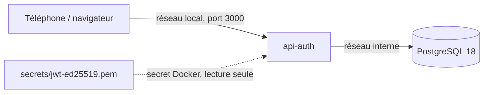

# Déployer sur le serveur maison

Cible : la VM Debian avec Docker du parcours `parcours-serveur` (Proxmox, HP ProDesk).



==La base n'a aucun port ouvert : seule l'API la joint.==

## Première installation

Dans le clone du dépôt, sur la VM :

```bash
npm run cle:generer                    # écrit secrets/jwt-ed25519.pem (0600)
cp deploiement/.env.example deploiement/.env
nano deploiement/.env                  # DB_PASSWORD, CORS_ORIGINS
docker compose -f deploiement/compose.yaml up -d --build
docker compose -f deploiement/compose.yaml run --rm api npm run db:migrate
curl http://localhost:3000/healthz
curl http://localhost:3000/dbcheck
```

- `npm run cle:generer` demande Node sur la VM. Sans Node :
  `openssl genpkey -algorithm ed25519 -out secrets/jwt-ed25519.pem && chmod 600 secrets/jwt-ed25519.pem`.
- Le conteneur tourne avec l'utilisateur `node` (uid **1000**) : le fichier de clé doit lui
  appartenir (`chown 1000:1000 secrets/jwt-ed25519.pem`), sinon l'API refuse de démarrer.

## Mettre à jour

```bash
git pull
docker compose -f deploiement/compose.yaml run --rm api npm run db:migrate   # migration d'abord
docker compose -f deploiement/compose.yaml up -d --build                     # code ensuite
```

## À sauvegarder

- **La clé** `secrets/jwt-ed25519.pem` : la perdre déconnecte tout le monde (rien d'autre).
- **La base** :
  `docker compose -f deploiement/compose.yaml exec base pg_dump -U api_auth api_auth > sauvegarde.sql`.
- Règle 3-2-1 : voir l'étape 06 de `parcours-serveur`.

## Plus tard, avec un nom de domaine

1. Sous-domaine `auth.mondomaine.fr` (étape 03 de `parcours-serveur`).
2. Traefik + HTTPS (étape 05) : retirer `ports`, ajouter le réseau `proxy` et les labels
   commentés dans `compose.yaml`, mettre `TRUST_PROXY_HOPS=1`.
3. `JWT_EMETTEUR=https://auth.mondomaine.fr` : les autres applications vérifient l'émetteur.
   Changer l'émetteur invalide les jetons d'accès en cours (15 min au plus).
4. Envoi d'emails et double authentification : [Soria54/api-auth#1](https://github.com/Soria54/api-auth/issues/1).
