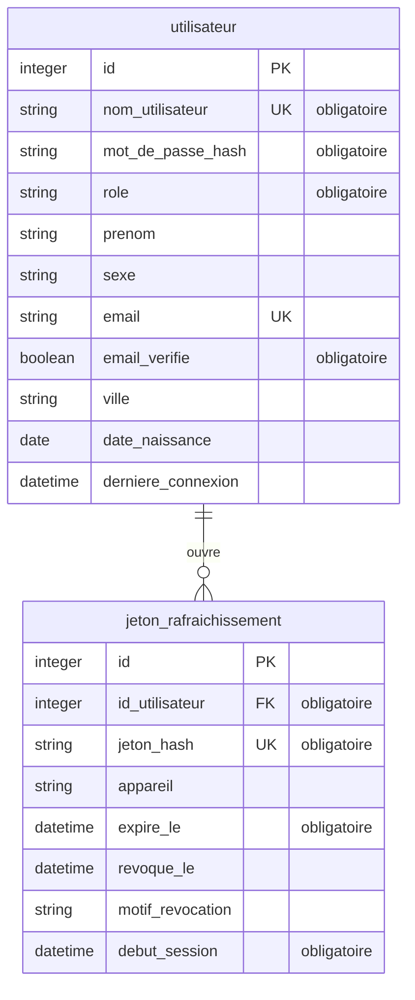

# Structure de la base de données

> Source de vérité du schéma, **validée avant la création des modèles**. Chaque migration la
> met à jour. Le test `tests/integration/schemaBdd.test.js` échoue si les modèles Sequelize
> s'en écartent.

## Convention

- Une entité = une table, en `snake_case` au singulier.
- Un attribut par ligne : `type nom [PK|FK|UK] ["obligatoire"]`.
- Types : `string`, `text`, `integer`, `decimal`, `boolean`, `date`, `datetime`.
- `integer id PK` toujours écrit ; `created_at` et `updated_at` sont implicites.
- Relation : `projet ||--o{ tache : "contient"` (un projet, plusieurs tâches). La clé
  `id_projet` est dans `tache`, marquée `FK`.
- Lignes `%% @@…` : repères des scripts du plugin, à garder.

## Choix et règles liés aux données

### `utilisateur`

| Colonne              | Type          | Obligatoire | Unique | Rôle                                                                                         |
| -------------------- | ------------- | ----------- | ------ | -------------------------------------------------------------------------------------------- |
| `nom_utilisateur`    | `string(30)`  | oui         | oui    | Identifiant de connexion. Minuscules (`CHECK`) ; `a-z0-9._-`, 3 à 30 caractères (validateur) |
| `mot_de_passe_hash`  | `string(255)` | oui         |        | scrypt `scrypt$<sel>$<empreinte>`, jamais renvoyé                                            |
| `role`               | `string(50)`  | oui         |        | `utilisateur` (défaut) ou `admin` (`CHECK`)                                                  |
| `prenom`             | `string(100)` |             |        |                                                                                              |
| `sexe`               | `string(20)`  |             |        | `femme`, `homme`, `autre` (contrainte `CHECK`)                                               |
| `email`              | `string(255)` |             | oui    | Minuscules (`CHECK`) ; plusieurs comptes sans email possibles                                |
| `email_verifie`      | `boolean`     | oui         |        | Faux par défaut ; repasse à faux si l'email change                                           |
| `ville`              | `string(100)` |             |        | **Pas d'adresse postale** : la ville seulement                                               |
| `date_naissance`     | `date`        |             |        | Entre 1900-01-01 et hier (validateur)                                                        |
| `derniere_connexion` | `datetime`    |             |        | Mise à jour à chaque connexion réussie                                                       |

- Pas de poids ni de taille : données de l'application musculation
  ([Soria54/musculation#13](https://github.com/Soria54/musculation/issues/13)).
- Pas de photo.
- Nom d'utilisateur **non modifiable** par l'utilisateur : les autres applications s'appuient
  sur l'identifiant `id` (claim `sub`) et peuvent afficher le nom.

### `jeton_rafraichissement`

| Colonne            | Type          | Obligatoire | Unique | Rôle                                                                   |
| ------------------ | ------------- | ----------- | ------ | ---------------------------------------------------------------------- |
| `id_utilisateur`   | `integer`     | oui         |        | Compte ; `ON DELETE CASCADE`                                           |
| `jeton_hash`       | `string(64)`  | oui         | oui    | SHA-256 hex du jeton (le jeton n'est jamais stocké)                    |
| `appareil`         | `string(255)` |             |        | Libellé libre envoyé à la connexion                                    |
| `expire_le`        | `datetime`    | oui         |        | Création + 30 jours                                                    |
| `revoque_le`       | `datetime`    |             |        | Rotation, déconnexion, changement de mot de passe                      |
| `motif_revocation` | `string(20)`  |             |        | `rotation`, `deconnexion`, `toutes_sessions`, `mot_de_passe` (`CHECK`) |
| `debut_session`    | `datetime`    | oui         |        | Connexion d'origine, recopiée à chaque rotation (90 jours max)         |

- Une ligne révoquée est gardée jusqu'à son expiration. Si un jeton remplacé par **rotation**
  revient plus de 10 secondes après, c'est une copie : toutes les sessions du compte sont
  fermées. Un jeton fermé par une déconnexion est seulement refusé.
- Une session dure 90 jours au plus, rotations comprises (`debut_session`).
- Les lignes expirées d'un compte sont supprimées à chaque connexion ou rotation de ce compte.
  Un compte qui ne revient jamais garde les siennes : purge périodique prévue (voir `CLAUDE.md`).
- Index sur `id_utilisateur` (fermer toutes les sessions d'un compte).

<!-- @@regles-donnees -->
