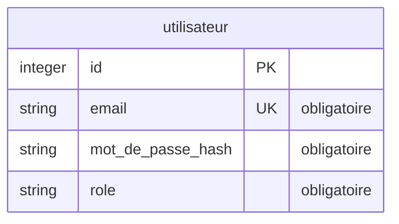

# Structure de la base de données

> Source de vérité du schéma, **validée avant la création des modèles**. Chaque migration la
> met à jour. Le test `tests/integration/schemaBdd.test.js` échoue si les modèles Sequelize
> s'en écartent.

## Convention

- Une entité = une table, en `snake_case` au singulier.
- Un attribut par ligne : `type nom [PK|FK|UK] ["obligatoire"]`.
- Types : `string`, `text`, `integer`, `decimal`, `boolean`, `date`, `datetime`.
- `integer id PK` toujours écrit ; `created_at` et `updated_at` sont implicites.
- Relation : `projet ||--o{ tache : "contient"` (un projet, plusieurs tâches). La clé
  `id_projet` est dans `tache`, marquée `FK`.
- Lignes `%% @@…` : repères des scripts du plugin, à garder.

## Choix et règles liés aux données

<!-- @@regles-donnees -->
